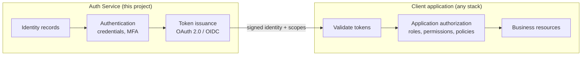

# 02 — Architecture and Design Decisions

> **Status:** proposed — awaiting review · **Last updated:** 2026-10-15 · Detailed records: [ADR directory](architecture/architecture-decision-records/)

## Decision summary

| # | Decision | Status | Record |
|---|---|---|---|
| 1 | Build a **centralized identity provider with SSO** (option A below), not a shared engine or per-app users | Accepted | [ADR-0001](architecture/architecture-decision-records/ADR-0001-build-centralized-idp-in-laravel.md) |
| 2 | Implement the IdP **in this Laravel application** (not Keycloak, not a hosted IdP) | Accepted | [ADR-0001](architecture/architecture-decision-records/ADR-0001-build-centralized-idp-in-laravel.md) |
| 3 | Protocol: **OAuth 2.0 + OpenID Connect**, Authorization Code + PKCE for all public clients; ROPC never | Accepted | this document, [authentication-flows](api/authentication-flows.md) |
| 4 | **Authorization stays in client apps**; the IdP issues identity and scopes only | Accepted | this document |
| 5 | OAuth/OIDC server package (Passport vs `league/oauth2-server` + OIDC extension) | **Deferred** — decided when Phase 8 is authored | [ADR-0002](architecture/architecture-decision-records/ADR-0002-oauth-oidc-server-package.md) |
| 6 | Single tenant; organization-ready schema | Accepted | [ADR-0003](architecture/architecture-decision-records/ADR-0003-single-tenant-with-org-extension-path.md) |
| 7 | Free-tier deployment: Supabase Postgres + free PHP host | Accepted | [ADR-0004](architecture/architecture-decision-records/ADR-0004-free-tier-deployment.md) |

## The problem being solved

Five application types (Laravel server-rendered, Laravel REST APIs, React SPA, React Native apps, future clients) need to know *who the user is* without each re-implementing credentials, recovery, MFA, and token security. The service must be deployable on its own and reusable — which rules out anything coupled to a specific client's codebase or database.

## Option comparison

### Option A — Centralized identity provider with SSO *(chosen)*

One service owns identities, credentials, and token issuance. Client applications redirect users to it, receive signed assertions, and enforce their own permissions.

### Option B — Shared authentication engine, per-application user databases

A reusable Laravel package (or duplicated service layer) that each application runs against **its own** users table.

### Option C — Integrate a mature identity provider

Either self-hosted (e.g., Keycloak) or hosted (Auth0, AWS Cognito): Laravel integrates rather than implements.

| Criterion | A: Central IdP (build) | B: Shared engine | C1: Keycloak | C2: Hosted IdP |
|---|---|---|---|---|
| SSO across apps | ✅ by design | ❌ each app has separate users | ✅ | ✅ |
| Central account lockout / revocation | ✅ one place | ❌ per-app | ✅ | ✅ |
| Reuse without lock-in | ✅ ours | ⚠️ code reuse only | ⚠️ JVM ecosystem | ❌ vendor-coupled |
| Learning value (backend + security) | ✅ maximal | ⚠️ partial | ❌ integration only | ❌ integration only |
| Security risk ownership | ❌ **we own it** | ❌ we own it, N times | ✅ battle-tested | ✅ vendor |
| Ops burden | Medium (one PHP app) | Low per app | High (JVM, memory-hungry on free tiers) | Low |
| Cost at this scale | Free tier OK | Free tier OK | Free tier usually **insufficient RAM** | Free tiers exist, then paid |
| Time to production | Slowest | Medium | Fast | Fastest |

**Why A wins here:** the two hard requirements — *independently deployable and reusable* — plus the primary stakeholder's goal of learning backend security make the build-in-Laravel IdP the right trade-off. B fails the reuse test structurally: it reuses *code*, not *identity*, so there is no SSO, no central revocation, and every app still owns credential risk. C fails the learning and cost/lock-in tests (C1 additionally fails the free-tier RAM constraint — a serious operational problem, not a preference).

**The honest cost of A:** we become responsible for password storage, token security, and the OAuth/OIDC attack surface. This is accepted knowingly and mitigated by: (1) strict standards compliance — RFC 6749/7636/9700, OIDC Core/Discovery — rather than inventing protocol behavior; (2) per-phase threat models against OWASP ASVS; (3) a dedicated security-validation gate (Phase 11) before anything production-shaped. If the project later outgrows this, the client-side integration surface stays standards-based, so migrating to an external IdP later does not rewrite client apps — that is deliberate insurance.

## Authentication, authorization, identity — the boundary

- The service proves **who** the user is and issues signed assertions.
- It publishes **scopes** — coarse, service-level claims (`openid`, `profile`).
- It **never** decides what a user may access inside a client application. Authentication must never automatically grant access to a client's protected resources; a valid token is a *precondition*, not a permission.

This split is what allows every client app to keep its own authorization rules while sharing one identity.

## Protocol selection

### Why OIDC on OAuth 2.0 (vs cookie sessions / opaque tokens)

| Approach | Verdict | Reasoning |
|---|---|---|
| Cookie sessions only | ❌ insufficient | Works for one first-party site; cannot serve mobile apps or cross-origin SPAs without fragile cookie plumbing; no standard delegation semantics |
| Opaque bearer tokens (custom) | ❌ rejected | Every API call requires a lookup/introspection against the IdP (coupling + availability risk); validation protocol is bespoke per client |
| OAuth 2.0 alone | ⚠️ incomplete | An *authorization* framework; using it raw for authentication has well-documented pitfalls (token substitution) — exactly why OIDC exists |
| **OAuth 2.0 + OIDC** | ✅ chosen | Authentication semantics (ID tokens), standard discovery so clients auto-configure, off-the-shelf client libraries for React/RN/Laravel, local JWT validation with published keys |

### Flow per client type

| Client | Flow | Client type | Token storage (documented per client in Phase 13) |
|---|---|---|---|
| React SPA | Authorization Code + PKCE (S256) | Public | Access token in memory; refresh via httpOnly cookie (BFF) or rotating refresh token |
| React Native | Authorization Code + PKCE (S256), system browser (ASWebAuthenticationSession / Custom Tabs) | Public | Refresh token in Keychain/Keystore; access token in memory |
| Laravel server-rendered / API backend | Authorization Code + PKCE | Confidential (client secret server-side) | Tokens server-side only |
| Service-to-service (machine) | Client Credentials | Confidential | Never in browsers/apps |

**Explicitly rejected:** Resource Owner Password Credentials (deprecated by OAuth 2.1 and the Security BCP — kills MFA, phishes users through the client), and the Implicit grant (token exposure in URLs).

### Token design targets

Finalized in Phases 4 and 8; stated now as design targets so all documents agree:

- **Access tokens**: JWT, ≤ 10-minute lifetime, signed with an asymmetric algorithm (RS256/ES256) so client backends validate locally via JWKS; issuer and audience claims always set and validated.
- **Refresh tokens**: opaque (random), stored **hashed** server-side, single-use with rotation and family revocation on reuse detection, ~30-day sliding lifetime.
- **Signing keys**: asymmetric, rotatable via environment-provided key material (required by ephemeral free-tier filesystems — [ADR-0004](architecture/architecture-decision-records/ADR-0004-free-tier-deployment.md)); rotation procedure documented in Phase 8.
- **ID tokens**: issued per OIDC Core with `sub`, `aud`, `iss`, `auth_time`; consumed by clients for identity, never sent to APIs as bearer tokens.

## Deployment shape

One Laravel application + one PostgreSQL database (Supabase free tier) + a transactional email provider + a free PHP host. Queue workers and scheduler requirements are introduced by later phases (email sending, retention cleanup) and documented in [Phase 12](03-phase-roadmap.md). Details: [ADR-0004](architecture/architecture-decision-records/ADR-0004-free-tier-deployment.md).

## Consequences and accepted risks

1. **We own auth security.** Mitigated as described above; the Phase 11 gate is mandatory before production use.
2. **Free tier ≠ high availability.** Cold starts and auto-pause are accepted; NFR-005 (local JWT validation) bounds the blast radius of IdP downtime.
3. **Single-tenant schema now.** Organizations remain future work by decision, with an extension path that avoids a destructive rewrite.
4. **Package decision deferred (ADR-0002).** Phases 1–3 use only framework primitives and are unaffected; ADR-0002 must be accepted before Phase 4 design is finalized.
