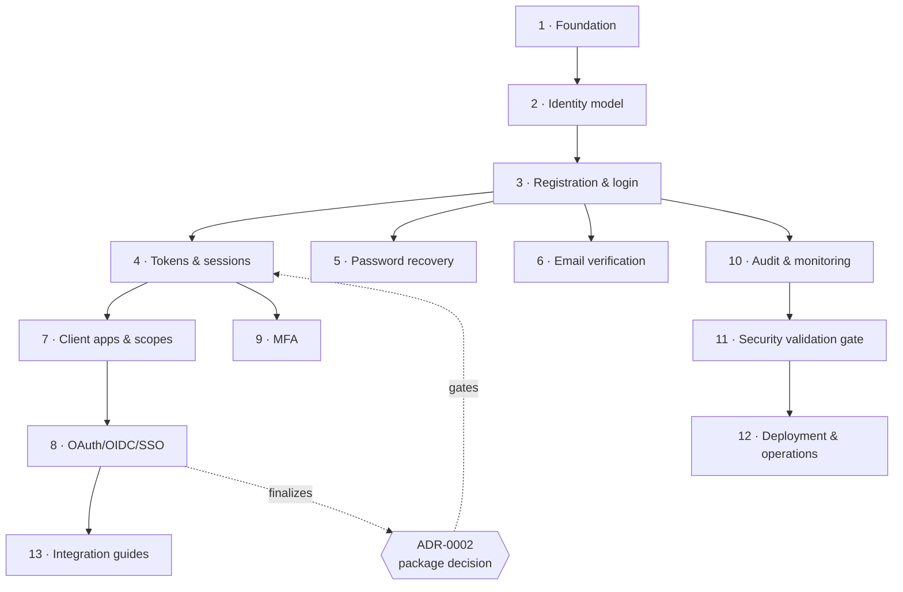

# 03 — Phase Roadmap

> **Status:** proposed — awaiting review · **Last updated:** 2026-10-15

## How phases work

- **Documentation gates documentation:** the detailed document for phase N is written only after phase N−1's document has been reviewed and approved.
- **Documentation gates code:** a phase is implemented only against its approved document, and validated section-by-section against it (functional requirements, security analysis, acceptance criteria).
- Every phase document follows the [A–M template](phases/phase-01-foundation.md) and ends with a completion checklist. Requirements carry phase-local ID prefixes that trace to the [product requirements](01-requirements-and-scope.md).
- Testing is **continuous**, not deferred: each phase ships its own tests per its testing-strategy section. Phase 11 is the cross-cutting validation and security hardening gate, not the first time tests run.

## Phase map

| # | Phase | Document | Depends on | Status | Core outcome |
|---|---|---|---|---|---|
| 1 | Foundation | [phase-01-foundation.md](phases/phase-01-foundation.md) | — | **Proposed — awaiting review** | `/api/v1` baseline: versioned routes, uniform error envelope, request IDs, base rate limiting, CORS config, working test suite |
| 2 | Identity model | phase-02-identity-model.md | 1 | Not started | User schema (ULID keys, status, security metadata), factories/seeders, model tests |
| 3 | Registration & login | phase-03-registration-and-login.md | 2 | Not started | IdP account-portal endpoints, hashing policy, throttling, anti-enumeration |
| 4 | Token & session management | phase-04-token-and-session-management.md | 3, ADR-0002 accepted | Not started | Refresh rotation + reuse detection, revocation, device sessions, session invalidation rules |
| 5 | Password recovery | phase-05-password-recovery.md | 3 | Not started | Enumeration-safe reset flow, single-use expiring tokens, post-reset revocation |
| 6 | Email verification | phase-06-email-verification.md | 3 | Not started | Verification lifecycle, signed links/codes, queryable state |
| 7 | Client apps & authorization model | phase-07-authorization-and-client-apps.md | 4 | Not started | Client registry (types, redirect URIs, scopes), first/third-party distinction |
| 8 | OAuth 2.0 + OIDC + SSO | phase-08-oauth-oidc-and-sso.md | 7; **finalizes ADR-0002** | Not started | Authorization Code + PKCE, discovery, `userinfo`, consent, logout; signing-key rotation |
| 9 | MFA & account security | phase-09-mfa-and-account-security.md | 4 | Not started | TOTP enrollment/verification, recovery codes, sensitive-change invalidation |
| 10 | Audit logging & monitoring | phase-10-audit-logging-and-monitoring.md | 3–9 | Not started | Append-only audit trail, structured logs, retention job, alerting hooks |
| 11 | Testing & security validation | phase-11-testing-and-security-validation.md | 1–10 | Not started | Full scenario matrix, authorization/negative/concurrency suites, ASVS checklist, security review |
| 12 | Deployment & operations | phase-12-deployment-and-operations.md | 11 | Not started | Supabase + host runbook, migrations, queues/mail, backups, key rotation, rollback |
| 13 | Client integration guides | phase-13-client-integration-guides.md | 8 | Not started | `integration/laravel.md`, `integration/react-web.md`, `integration/react-native.md` + working example snippets |

## Dependency graph

Note the deliberate overlap: audit logging (10) can proceed while MFA (9) is being authored — the graph shows hard dependencies only.

## Milestone views

- **M1 — Self-authenticating service** (phases 1–6): the IdP can manage identities and credentials for its own account portal end-to-end.
- **M2 — Consumable by applications** (phases 7–8): any registered client can run Authorization Code + PKCE against it.
- **M3 — Hardened** (phases 9–11): MFA, audit, and the security gate.
- **M4 — Deployed and documented for reuse** (phases 12–13): live on free-tier infrastructure, with integration guides a stranger could follow.

## Change control

If implementation reveals a needed architecture change, the change is **proposed first** (new/superseding ADR + edits to affected documents), explained to the stakeholder, and only then implemented. Approved architecture is never silently changed.
