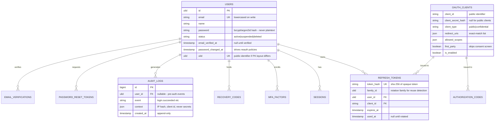

# 04 — Data Model and Database Design

> **Status:** proposed — awaiting review · **Last updated:** 2026-10-15 · This is the **target-state overview**. Each phase document details only the tables it introduces, with full column-level migrations. Exact OAuth/OIDC table names are finalized by [ADR-0002](architecture/architecture-decision-records/ADR-0002-oauth-oidc-server-package.md) in Phase 8.

## Design principles

1. **Public identifiers are ULIDs.** Users get ULID primary keys (sortable, URL-safe, non-enumerable — unlike auto-increment, which leaks user counts and enables scraping). High-volume internal tables (tokens, audit) may use bigint PKs where nothing external references them.
2. **Secrets are stored hashed.** Refresh tokens, reset tokens, and recovery codes are stored only as hashes. Anything that must be read back (e.g. client secrets for verification) uses Laravel's encrypted casting instead.
3. **Minimal PII.** Email and name only. No phone numbers, addresses, or birthdates in v1.
4. **Every security-sensitive column earns its place** — rationale is recorded next to each below.
5. **PostgreSQL parity.** Dev runs SQLite; production targets Supabase PostgreSQL. No SQLite-only pragmas in migrations; JSON columns used deliberately (both engines support them).
6. **Organization extension path** per [ADR-0003](architecture/architecture-decision-records/ADR-0003-single-tenant-with-org-extension-path.md): nothing in v1 assumes "one user belongs to exactly one org," so `organizations` + `organization_user` can be added additively later.

## Target schema (domain tables)

### Column rationale (security-sensitive fields)

| Field | Why it exists |
|---|---|
| `users.password` | Argon2id/bcrypt hash (Laravel default). Never selected into logs or API responses; hidden on the model. |
| `users.status` | Suspension/deactivation must propagate to **all** connected applications instantly — checked on every token issuance and refresh, not just login. |
| `users.email_verified_at` | Timestamp (not boolean) so audit can answer *when*, and clients can require verified identity per their own policy. |
| `users.password_changed_at` | Enables "re-authenticate if password changed after this token was issued" and post-reset revocation checks (AUTH-013/032). |
| `password_reset_tokens.token` | Stored hashed; single-use; short expiry. Laravel's stock `password_reset_tokens` table shape is reused and hardened in Phase 5. |
| `refresh_tokens.token_hash` | A leaked database must not yield usable refresh tokens. SHA-256 of a 256-bit random value. |
| `refresh_tokens.family_id` | Rotation family: presenting an already-rotated member revokes the whole family (reuse detection, AUTH-021). |
| `oauth_clients.redirect_uris` | Exact-match JSON array; the authorization-code interception defense depends on no wildcard matching (AUTH-052). |
| `oauth_clients.client_secret_hash` | Confidential clients authenticate with a secret; hashed at rest, rotatable without deleting the client (AUTH-054). |
| `oauth_clients.first_party` | Distinguishes "your own app's login screen" (no consent screen) from third-party clients (consent required, AUTH-055). |
| `sessions` | Laravel's stock table; retained because the IdP's own login/consent pages are session-backed. |
| `audit_logs.context` | Structured JSON, allow-listed keys; IP addresses stored hashed or truncated per the privacy NFR-009. |

## Tables deliberately *not* created

| Candidate | Why not |
|---|---|
| `roles` / `permissions` | Authorization belongs to client applications (decision 4 in [02](02-architecture-and-design-decisions.md)). The IdP has an admin distinction internal to operations, not a user-facing RBAC system. |
| `organizations` / `organization_user` | Deferred by [ADR-0003](architecture/architecture-decision-records/ADR-0003-single-tenant-with-org-extension-path.md); the path to add them is additive. |
| `user_profiles` | Minimal PII principle; profile data is not an authentication concern. |
| `oauth_access_tokens` (persisted) | Planned design: access tokens are self-contained JWTs validated locally by clients — no per-request DB lookup (NFR-005). Revocation is enforced through short lifetimes + refresh-token revocation. If ADR-0002's chosen package persists them anyway, that is an accepted trade-off documented in Phase 8. |

## Migration and rollback considerations

- Each phase ships its migrations with `down()` methods that reverse cleanly; phases are validated by running `migrate:fresh` in tests.
- Destructive changes to existing tables (e.g. re-keying `users` to ULIDs in Phase 2) happen **once, early**, while the user table contains only seeded data — after Phase 3 they become real migrations with data-backfill plans.
- SQLite (dev/tests) vs PostgreSQL (production): migrations avoid engine-specific column types and defaults; the Phase 12 pipeline proves both.
- No soft-deletes in v1 tables except where stated; deactivation is a status flag so foreign keys and audit history stay intact, with a hard-purge retention job defined in Phase 10.

## Data ownership

All tables are owned by the auth service. Client applications **never** connect to this database — they consume the API/OIDC interfaces only. This is the trust boundary that keeps the service independently deployable and replaceable.
