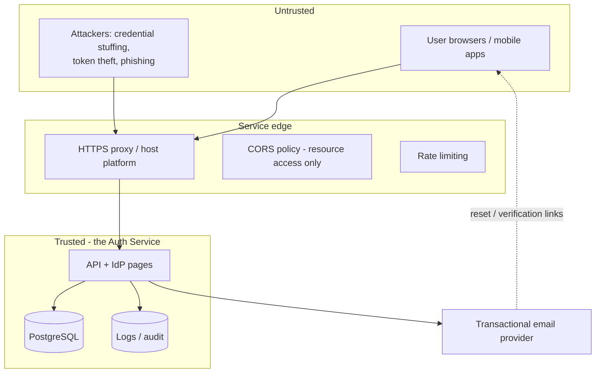

# 06 — Security Threat Model

> **Status:** proposed — awaiting review · **Last updated:** 2026-10-15 · This is the **system-wide** model. Each phase document contains its own Security analysis (template section I) with phase-specific threats, likelihood/impact/mitigation/validation — this file is the map, not the full catalogue.

## Scope and method

- **Assets:** user credentials (hashes), session cookies, refresh tokens, signing keys (`APP_KEY`, OAuth signing keys), client secrets, PII (email, name), audit logs, the registration/recovery email channel.
- **Actors:** end users, client applications (trusted-but-buggy), anonymous internet attackers, a malicious or compromised client application, and operators (us).
- **Method:** assets → trust boundaries → threat categories (STRIDE-informed) → per-phase controls mapped to [OWASP ASVS 4.0.3](https://owasp.org/www-project-application-security-verification-standard/) chapters. The Phase 11 gate walks this model end-to-end.

## Trust boundaries

Boundaries: (1) internet → service edge (TLS termination, rate limiting); (2) service → database (private, credentials via env); (3) service → email provider (API key via env; the email channel itself is treated as hostile — reset links must be single-use and expiring); (4) client applications → service (trusted identity, untrusted permission decisions).

## Top system-level threats

Likelihood (L) / impact (I): low–high. Detailed mitigations and validation tests live in the referenced phase documents.

| # | Threat | L | I | Primary mitigation | Detailed in |
|---|---|---|---|---|---|
| T1 | Credential stuffing / brute force | high | high | Per-account + per-IP throttling with escalation (AUTH-011), uniform failure responses (AUTH-010), NIST-aligned policy (AUTH-004) | Phases 3, 11 |
| T2 | User enumeration (login, register, reset) | high | med | Identical responses/timing regardless of account existence; rate-limited endpoints | Phases 3, 5 |
| T3 | Password storage compromise | low | critical | Argon2id/bcrypt with sane cost; hashes never logged/serialized; `APP_KEY` + DB credentials only via env (NFR-002) | Phases 2, 12 |
| T4 | Refresh-token theft & replay | med | high | Rotation + family revocation on reuse (AUTH-021); hashed storage; per-client scoping | Phase 4 |
| T5 | Authorization-code interception | med | high | PKCE S256 mandatory for public clients (AUTH-051); exact redirect-URI matching (AUTH-052); short code TTL, single-use | Phase 8 |
| T6 | Open redirect via `redirect_uri`/`post_logout` params | med | high | Exact-match allow-lists, no wildcard matching, fail-closed | Phases 7, 8 |
| T7 | CSRF on IdP browser pages (login/consent) | med | high | Laravel CSRF middleware on session-backed pages; SameSite cookies | Phases 3, 8 |
| T8 | XSS on IdP pages stealing session/cookies | med | high | Escaped Blade output, CSP headers (Phase 12), HttpOnly+Secure+SameSite cookies | Phases 3, 12 |
| T9 | Signing-key leakage / weak randomness | low | critical | Keys via env/secret store, never in repo or logs; rotation runbook; framework CSPRNG for all token material | Phases 8, 12 |
| T10 | Broken object-level authorization (acting on another user's tokens/sessions) | med | high | Ownership checks on every token/session/recovery operation; authorization test suite | Phases 4, 11 |
| T11 | Excessive privileges via scopes | med | med | Narrow scope catalogue; per-client allowed scopes (AUTH-050); scopes ≠ app permissions | Phases 7, 8 |
| T12 | Secret leakage through logs/errors/docs | med | high | Allow-listed audit context (AUTH-061); generic 500 envelopes (NFR-002); secret-pattern checks in review | Phases 1, 10 |
| T13 | Abuse of public endpoints (registration/reset mail bombing) | high | med | Strict per-IP rate limits on mail-sending endpoints; neutral responses | Phases 3, 5 |
| T14 | Session fixation / incomplete logout | med | high | Session ID regeneration on login; logout invalidates server-side session (AUTH-012) and revocable refresh families | Phases 3, 4 |
| T15 | Account recovery takeover (email compromise) | med | high | Single-use expiring tokens, post-reset global revocation (AUTH-032), optional re-auth requirement | Phase 5 |
| T16 | Host/infrastructure exposure (free tier) | med | high | Ephemeral-filesystem assumptions (keys from env), platform-managed TLS, no SSH/FS access assumed | Phase 12 ([ADR-0004](architecture/architecture-decision-records/ADR-0004-free-tier-deployment.md)) |

## Mandatory controls vs optional hardening

**Mandatory (v1 blocks without them):** TLS everywhere non-local; hashed secrets at rest; PKCE for public clients; exact redirect matching; rate limiting on credential endpoints; anti-enumeration responses; CSRF on session pages; audit trail for auth events; generic production error pages (`APP_DEBUG=false`).

**Optional hardening (tracked, applied where cheap):** CSP + security headers beyond platform defaults (Phase 12); compromised-password checks against a breach corpus (Phase 3 stretch); per-account lockout notifications (Phase 10); IP hashing in audit logs (Phase 10); web-authn/passkeys (post-v1).

## Position statements (to prevent recurring design errors)

- **CORS is not authentication.** It controls which *browser origins* may read responses; curl and attackers ignore it. Every endpoint authenticates independently.
- **JWTs are signed, not encrypted.** Nothing sensitive goes in claims; the `sub` is a ULID, never an email.
- **A valid token is not permission.** Client apps enforce authorization; the service only asserts identity (decision 4, [02](02-architecture-and-design-decisions.md)).
- **Defense in depth over single controls**: short token TTLs + rotation + revocation + audit together cover what any one of them misses.

## Validation plan

Phase 11 executes: the ASVS chapter checklist (V2 authentication, V3 session management, V4 access control, V5 validation/encoding), the threat table above re-walked with evidence (test names or documented residual risk), and negative/abuse test suites (enumeration timing, reuse detection, redirect tampering, scope escalation). Until then, each phase's acceptance criteria include its own threat validations.
