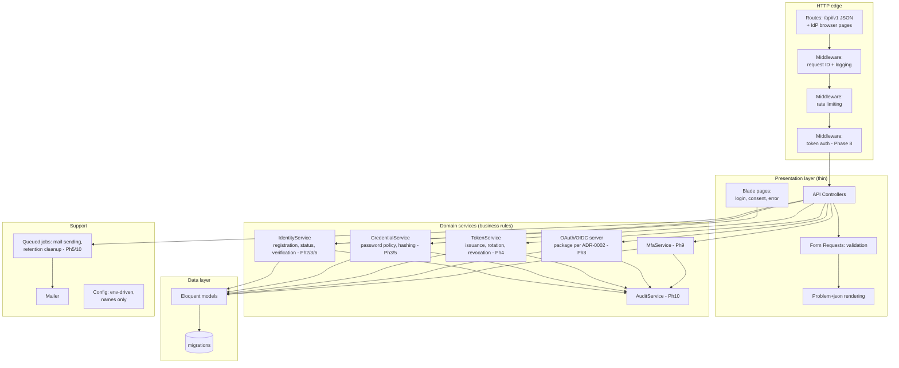

# Component Design (C4 Level 2)

> **Status:** proposed — awaiting review · **Last updated:** 2026-10-15 · Context: [system-context.md](system-context.md) · Behavior: [sequence-diagrams.md](sequence-diagrams.md)

## Component diagram

Components appear phase by phase — the table below states which phase introduces each. Nothing here exists yet (see the [repo assessment](../00-project-overview.md#current-repository-assessment)).



## Responsibilities

| Component | Responsibility | Phase |
|---|---|---|
| Middleware stack | Assign request ID, structured request log, rate limiting; later: bearer-token authentication and scope enforcement | 1 (auth: 8) |
| API Controllers | Translate HTTP ↔ service calls; **no business rules**, no DB queries beyond simple fetches | 1 onward |
| Form Requests | Declarative validation; uniform 422 problem+json | 1 onward |
| Problem+json renderer | Single place that shapes every error response (incl. 404/405/500) | 1 |
| IdentityService | User lifecycle: registration semantics, status transitions, verification state; anti-enumeration behavior lives at this boundary | 2, 3, 6 |
| CredentialService | Password hashing/policy, reset-token issue/consume, re-auth checks | 3, 5 |
| TokenService | Refresh-token families, rotation, reuse detection, revocation; session invalidation triggers | 4 |
| OAuth/OIDC server component | Protocol endpoints per RFC 6749/7636/OIDC; key management + JWKS; chosen package = [ADR-0002](architecture-decision-records/ADR-0002-oauth-oidc-server-package.md) | 8 |
| MfaService | TOTP enrollment/verification, recovery codes | 9 |
| AuditService | Append-only event recording with allow-listed context | 10 |
| Queued jobs | Async mail, retention/cleanup — keeps request paths fast and retry-safe | 5, 10 |

## Layering rules

1. Controllers call **services**; services own business rules and call models. Controllers never contain conditional business logic beyond HTTP concerns.
2. Services never echo HTTP concepts (status codes, problem+json) — they throw domain exceptions that the presentation layer maps to HTTP. This keeps rules testable without HTTP.
3. Cross-service side effects (e.g. "password reset → revoke tokens") are expressed as explicit service calls or events — never hidden inside model observers.
4. Configuration is read from `config()` which reads env by **name**; no service reads `env()` directly outside config files (Laravel config-caching rule).

## Failure handling

| Failure | Behavior |
|---|---|
| Validation failure | 422 problem+json with field errors — no partial side effects (validate before acting) |
| Domain rule violation | Mapped exception → 4xx problem+json with stable `code` |
| DB unavailable | 503-style problem+json on health endpoint (Phase 1); generic 500 elsewhere; details only in logs |
| Mail provider down | Queued job retries with backoff; the triggering HTTP request still succeeds (mail is async by design, Phase 5) |
| Signing key invalid/missing | Fail closed: token issuance refuses to start; health endpoint reports degraded (Phase 8) |

## Request flow (steady state, post-Phase 8)

```mermaid
sequenceDiagram
    participant C as Client
    participant MW as Middleware
    participant CT as Controller
    participant SV as Domain service
    participant DB as PostgreSQL
    C->>MW: POST /api/v1/auth/login (JSON)
    MW->>MW: request ID, rate limit check
    MW->>CT: validated request
    CT->>SV: AttemptLogin(email, password)
    SV->>DB: fetch user, verify hash, check status
    SV-->>CT: result / domain exception
    CT-->>C: 200 JSON · or problem+json (stable code)
    Note over MW: response carries X-Request-Id; audit event emitted by service layer
```
