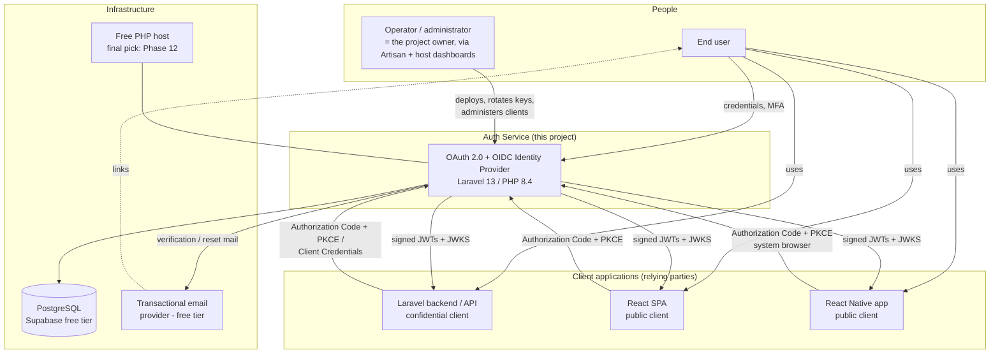

# System Context (C4 Level 1)

> **Status:** proposed — awaiting review · **Last updated:** 2026-10-15

The highest-level view: who and what interacts with the authentication service. Component internals are in [component-design.md](component-design.md); end-to-end behavior in [sequence-diagrams.md](sequence-diagrams.md).

## Actors and trust

| Actor | Trust level | Notes |
|---|---|---|
| End user | Untrusted identity claim until authenticated | Interacts via browsers (SPA/IdP pages) and mobile system browsers |
| Client applications | Trusted identity consumers, **untrusted permission deciders** | They validate our tokens but make their own authorization decisions; a compromised client must not be able to harm other clients (scope + audience isolation) |
| Operator | Fully trusted (uses secrets) | Runs deployments, key rotation, client registration via Artisan/host console |
| Email provider | Semi-trusted delivery channel | Reset/verification links are single-use and expiring precisely because the channel is not fully trusted |
| Host platform / proxy | Trusted infrastructure | Terminates TLS; filesystem assumed **ephemeral** (see [ADR-0004](architecture-decision-records/ADR-0004-free-tier-deployment.md)) |

## Key interactions

1. **User → client app → IdP → client app**: the Authorization Code + PKCE round trip (detailed in [sequence-diagrams.md](sequence-diagrams.md)).
2. **Client backend → IdP**: JWKS fetch to validate access tokens locally (cached; IdP downtime does not block client APIs during access-token lifetime — NFR-005).
3. **IdP → email → user**: verification and recovery links.
4. **Operator → IdP**: deployment, client registration, key rotation — out-of-band of the HTTP API.

## What is deliberately absent

- No client application connects to the database directly (data ownership boundary, [04](../04-data-model-and-database-design.md)).
- No agent/sidecar on client apps: integration is pure HTTP + standards, so any platform can consume the service.
- No admin web UI in v1: operator actions are Artisan commands and documented procedures.
