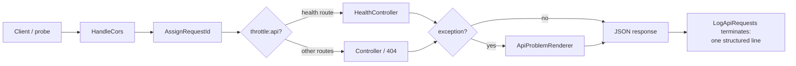

# Phase 1 — Foundation

> **Status:** proposed — awaiting review (approval gates implementation) · **Last updated:** 2026-10-15 · Product requirements traced: [01-requirements-and-scope.md](../01-requirements-and-scope.md)

## A. Phase overview

| | |
|---|---|
| **Phase** | 1 of 13 — Foundation |
| **Purpose & business value** | Lay the API baseline every later phase builds on: versioned routes, a uniform error contract, request correlation, rate limiting, CORS, and a trustworthy test suite. Done once here, never argued about again. |
| **Problems solved** | Today the repo has no `routes/api.php`, no error contract, no CORS configuration, no rate limiting, no request IDs, and a failing stock test. Every subsequent endpoint would otherwise invent these ad hoc. |
| **Scope** | `/api/v1` route skeleton; health endpoint; problem+json error envelope for all `/api/*` failures; request-ID middleware + structured request logging; per-IP API rate limiting; explicit CORS allow-list; fate of the tutorial demo routes; green Pest suite. |
| **Explicitly excluded** | Any user/account/token functionality (Phases 2+); authentication/authorization middleware (nothing to authenticate yet); database schema changes; queues/mail; deployment. |
| **Dependencies on earlier phases** | None — first phase. Architecture docs ([02](../02-architecture-and-design-decisions.md), [05](../05-api-contracts-and-error-handling.md)) are its input. |
| **Assumptions** | Laravel 13.34 / PHP 8.4 / Pest 5.3 as verified in the [repo assessment](../00-project-overview.md#current-repository-assessment); SQLite locally; `APP_KEY` set. |
| **Unresolved decisions** | (1) Demo routes: relocate-then-remove (default below) vs delete now — confirm at review. (2) Health-check polling strategy — deferred to Phase 12 monitoring. |

## B. Learning objectives

Before implementing, you should be comfortable with these concepts:

1. **Versioned API surface (`/api/v1`).** Like shipping a native module with a stable interface — clients depend on paths and shapes, so breaking changes need a new version, not edits. URI versioning is the simplest cache-friendly approach.
2. **A uniform error contract (RFC 9457 problem+json).** Every failure — route not found, validation, throttling, crash — has one JSON shape with a stable machine `code`. In React Native terms: one error type your `fetch` wrapper can switch on, instead of parsing HTML error pages or guessing from status codes.
3. **Request IDs and structured logging.** One ID per request, returned to the client and printed in the server log line, so a user-reported problem is one `grep`. This is your backend equivalent of tagging every network call with a trace ID in Sentry.
4. **Middleware pipeline.** Laravel middleware wraps every request like an axios interceptor, but server-side and ordered: request ID → throttle → controller. Later phases insert token authentication here.
5. **Rate limiting as a brake, not a lock.** `RateLimiter::for()` defines named limiters; `throttle:api` enforces per-IP limits. It protects against abuse and typo-driven hammering; it is **not** an authentication or authorization mechanism (nothing in this phase is).
6. **CORS ≠ auth.** CORS tells *browsers* which origins may read responses. curl ignores it entirely. We configure a strict allow-list because our React SPA will call this API, and we still authenticate every request independently.
7. **Why health checks are separate from `/up`.** Laravel's built-in `/up` proves the app booted. Our `/api/v1/health` additionally proves the database answers — the difference operators care about on free-tier hosts where databases auto-pause ([ADR-0004](../architecture/architecture-decision-records/ADR-0004-free-tier-deployment.md)).

## C. Functional requirements

Scenarios cover success, invalid input, abuse, and edge cases. "Unauthorized" scenarios are N/A this phase — there is nothing to authorize yet (stated explicitly rather than silently skipped).

| ID | Requirement |
|---|---|
| FOUND-001 | `GET /api/v1/health` returns HTTP 200 with `{"status":"ok","checked_at":"<ISO-8601 UTC>"}` when the app **and** its database connection are healthy. |
| FOUND-002 | When the app is up but the database is unreachable, the health endpoint returns HTTP 503 with `status: "degraded"` and code `common.service_unavailable` — never a 500, never a stack trace, never driver/host details. |
| FOUND-003 | All error responses under `/api/*` use the [problem+json envelope](../05-api-contracts-and-error-handling.md#error-envelope--rfc-9457-problem-details) with `code` and `request_id` members — including 404, 405, 422, 429, and 500. |
| FOUND-004 | Validation failures (422) include an `errors` object mapping field → message array. |
| FOUND-005 | Malformed JSON request bodies return 400 `common.invalid_request` (not a 500), without side effects. |
| FOUND-006 | Every `/api/*` response carries an `X-Request-Id` header; IDs are ULIDs generated server-side per request. |
| FOUND-007 | Every `/api/*` request produces one structured log line containing: request ID, method, path, status, duration ms. No headers, bodies, or query strings are logged. |
| FOUND-008 | `/api/v1` routes (except `/health`) are rate-limited per IP at a configurable limit (env name `RATE_LIMIT_API_PER_MIN`, default 60/min). Exceeding it returns 429 `common.rate_limited` with a `Retry-After` header. |
| FOUND-009 | `/api/v1/health` is exempt from rate limiting so uptime probes never get throttled. |
| FOUND-010 | Duplicate/accidental `OPTIONS` preflight requests are answered by the CORS layer without hitting rate limits or controllers (standard Laravel `HandleCors` behavior, verified by test). |
| FOUND-011 | CORS is configured with an explicit origin allow-list sourced from the `FRONTEND_ORIGINS` env var (comma-separated); wildcard `*` together with credentials is impossible by configuration structure. |
| FOUND-012 | Unknown `/api/*` paths return 404 problem+json (not an HTML page), including when the request lacks an `Accept: application/json` header. |
| FOUND-013 | Route names follow `api.v1.*` (e.g. `api.v1.health`) — named routes are the contract future docs link to. |
| FOUND-014 | The three tutorial demo routes get a decided fate (default: relocated under `/api/v1/demo/*` and marked deprecated, removed in Phase 2) — no silent removal. |
| FOUND-015 | The existing `tests/Feature/ExampleTest.php` (currently failing: hits a removed `/` route) is updated and green. |
| FOUND-016 | With `APP_DEBUG=false`, an induced server error yields a generic 500 problem+json (`common.server_error`); internals appear only in logs keyed by the request ID. |

**Business rules:** none yet — no domain. **Concurrent requests:** no shared mutable state introduced (middleware is stateless; rate limiter is atomic via Laravel's cache-based limiter). **Network failures/retries:** all Phase 1 endpoints are safe to retry (GET health is idempotent; error paths have no side effects).

## D. Non-functional requirements

| ID | Category | Requirement | Why | Verified by |
|---|---|---|---|---|
| PN-001 | Performance | Health p95 < 50 ms locally; other API p95 < 100 ms | Login flows sit on this baseline | Phase 1 feature tests + `php artisan about` sanity; formal measurement in Phase 11 |
| PN-002 | Scalability | No filesystem or in-process state per request | Free-tier hosts run small, replaceable workers ([ADR-0004](../architecture/architecture-decision-records/ADR-0004-free-tier-deployment.md)) | Architecture test: no `file` cache/session driver usage in API paths; review |
| PN-003 | Reliability | Error handling never varies by `Accept` header on `/api/*` | Clients and attackers get identical behavior — predictability is a security property | FOUND-012 test with and without header |
| PN-004 | Availability | Health distinguishes app-up from db-down (FOUND-002) | Auto-pausing free-tier DBs make this operationally real | Feature test with mocked failing connection |
| PN-005 | Maintainability | Pint-clean; Pest tests per requirement; controllers ≤ ~50 lines | The service will outlive enthusiasm | `vendor/bin/pint --dirty`; review checklist |
| PN-006 | Observability | One log line per request with correlation ID (FOUND-007) | Incident triage without console.log archaeology | Feature test asserting log channel receives the line |
| PN-007 | Privacy | No request bodies/headers in logs | Emails and tokens will flow through here in later phases | Log-format test + review |
| PN-008 | Compatibility | No new package dependencies; SQLite/Postgres-neutral | Package decisions are gated ([ADR-0002](../architecture/architecture-decision-records/ADR-0002-oauth-oidc-server-package.md)); DB parity (NFR-010) | `composer show --direct` diff = empty |
| PN-009 | Security | See section I — CORS posture, generic errors, throttling baseline | Foundation controls compound in later phases | Section I validation column |
| PN-010 | Accessibility | N/A this phase — no human-facing UI; IdP pages arrive in Phase 3 | Stated, not skipped | — |

## E. Architecture and design

**Components introduced** (all inside the existing Laravel skeleton — no new folders beyond convention):

| Component | File (created in step H) | Responsibility |
|---|---|---|
| API route file | `routes/api.php` | `/api/v1` route definitions, two groups: throttled API + exempt health |
| Health controller | `app/Http/Controllers/Api/V1/HealthController.php` | App + DB probe, degraded-state mapping |
| Problem renderer | `app/Support/Api/ApiProblemRenderer.php` | Single place that converts any Throwable/validation into problem+json |
| Request-ID middleware | `app/Http/Middleware/AssignRequestId.php` | ULID per request → `X-Request-Id` response header + log context |
| Request-logging middleware | `app/Http/Middleware/LogApiRequests.php` | Terminable middleware: one structured line per API request |
| Rate limiter | `app/Providers/AppServiceProvider.php` (boot) | Named `api` limiter: per-IP, limit from config |
| CORS config | `config/cors.php` (published) | Explicit origins from `FRONTEND_ORIGINS`, `api/*` paths only |

**Request/response flow:**



**Trust boundaries:** the entire `/api/v1` surface is public (unauthenticated by design this phase). The health endpoint is intentionally reachable by anonymous probes — it must therefore leak nothing beyond up/degraded. **External dependencies:** the database (probed, may fail); the cache store backs the rate limiter (array driver locally — acceptable for tests, and free-tier production uses the database-backed cache per [ADR-0004](../architecture/architecture-decision-records/ADR-0004-free-tier-deployment.md)). **Database interactions:** one trivial `SELECT 1` in the health check. **Failure handling:** DB down → FOUND-002; renderer itself throwing → Laravel's last-resort handler still emits problem+json on `/api/*` (verified by test).

## F. Database design

**No schema changes this phase.** Recorded deliberately: the stock `users`/`sessions`/`cache`/`jobs` migrations remain untouched; identity modeling is [Phase 2](../03-phase-roadmap.md). The health check performs a literal `SELECT 1` — engine-neutral across SQLite (dev) and PostgreSQL (production, NFR-010). Rollback consideration: none needed — zero migrations shipped.

## G. API specification

### `GET /api/v1/health`

| | |
|---|---|
| Purpose | Liveness + DB readiness probe |
| Authentication | None (public, by design; exempt from throttling) |
| Required headers | none |

**Success — 200:**
```json
{ "status": "ok", "checked_at": "2026-10-15T19:30:00Z" }
```

**Degraded — 503** (DB unreachable):
```json
{
  "type": "https://auth.example.test/problems/service-unavailable",
  "title": "Service unavailable",
  "status": 503,
  "detail": "The service is temporarily unable to handle requests.",
  "instance": "/api/v1/health",
  "code": "common.service_unavailable",
  "request_id": "req_01JD6ZG3EXAMPLE"
}
```

### Error envelope (applies to every `/api/*` failure)

Illustrative examples of the contract from [05](../05-api-contracts-and-error-handling.md) that Phase 1 must make real:

**404** unknown path → `common.not_found` · **405** wrong method → `common.method_not_allowed` · **400** malformed body → `common.invalid_request` · **422** validation → `common.validation_failed` + `errors` · **429** throttled → `common.rate_limited` + `Retry-After: 60` · **500** unhandled → `common.server_error` (generic detail).

### Rate limiting behavior

Per-IP, per-minute on all `/api/v1` routes except `/health`; 429 responses include `Retry-After`. Headers `RateLimit-Limit` / `RateLimit-Remaining` / `RateLimit-Reset` on throttled routes. **Idempotency:** all Phase 1 endpoints are safe to retry. **Token/session side effects:** none exist yet. **Audit events:** none yet (audit trail arrives Phase 10; this phase's log line is operational, not security audit).

## H. Detailed implementation plan

Ordered steps. **Verify every Artisan command's flags with `php artisan <command> --help` before running** — the docs check below assumes Laravel 13.34 defaults, verified 2026-10-15. No new composer packages (PN-008).

**Step 0 — Baseline.** Run `php artisan test --compact` (expect the known ExampleTest failure — confirm, don't fix yet), `php artisan route:list`, `composer show --direct`. *Why:* documented starting point; the plan claims nothing unverified.

**Step 1 — API route file.** Create `routes/api.php` (manual — avoids `install:api`'s optional Sanctum prompts; Sanctum is deliberately **not** being added: this project *is* the IdP, and package choices are gated by [ADR-0002](../architecture/architecture-decision-records/ADR-0002-oauth-oidc-server-package.md)). Register it in `bootstrap/app.php` via `->withRouting(api: __DIR__.'/../routes/api.php', ...)`. Define the health route (name `api.v1.health`, no throttle) and a throttled `api` group for everything else. *Verify:* `php artisan route:list --path=api`.

**Step 2 — Health controller.** `php artisan make:class` is for generic classes; controllers use `php artisan make:controller Api/V1/HealthController --no-interaction` (check `--help` for invokable flag). Logic: try `DB::select('select 1')` → 200 payload; catch → 503 problem+json via the renderer. Keep it ~25 lines.

**Step 3 — Problem renderer.** Create `app/Support/Api/ApiProblemRenderer.php` (PSR-4 autoloaded; `app/Support` is conventional, not a new base folder requiring approval — flag at review if unwanted). Wire it in `bootstrap/app.php` `->withExceptions(...)`: map `NotFoundHttpException`→404, `MethodNotAllowedHttpException`→405, `ValidationException`→422 with `errors`, `ThrottleRequestsException`→429 with `Retry-After`, everything else→500 generic when `config('app.debug')` is false. Illustrative shape (not the implementation):
```php
$exceptions->render(fn (Throwable $e, Request $r) => app(ApiProblemRenderer::class)->render($e, $r));
```
*Verify:* manual `curl` of a bogus `/api/*` path → problem+json.

**Step 4 — Middleware.** `php artisan make:middleware AssignRequestId --no-interaction` and `... make:middleware LogApiRequests`. AssignRequestId: generate ULID (`Str::ulid()`), share via request attributes + response header. LogApiRequests: `terminate()` writes one line (request ID, method, path, status, ms) to the default channel. Register both on the `api` middleware group in `bootstrap/app.php`. *Verify:* `curl -i` shows `X-Request-Id`; `tail` the log.

**Step 5 — Rate limiter.** In `AppServiceProvider::boot()`: `RateLimiter::for('api', fn (Request $r) => Limit::perMinute((int) config('auth-service.rate_limit.api_per_min'))->by($r->ip()))`. Add `config/auth-service.php` reading env **names**: `RATE_LIMIT_API_PER_MIN`. Apply `throttle:api` to the non-health group (FOUND-009 exemption by grouping). *Why config indirection:* env is read only in config files (config-caching rule).

**Step 6 — CORS.** `php artisan config:publish cors --no-interaction` (verify command exists via `php artisan list config`), then edit `config/cors.php`: `paths => ['api/*']`, `allowed_origins` from `FRONTEND_ORIGINS` (exploded comma list, empty in production = deny-by-default), `supports_credentials => false` for now — revisited in Phase 8 when OIDC browser flows land. *Verify:* OPTIONS preflight request in a test.

**Step 7 — Demo routes decision (needs your confirmation at review).** Default: move `/user`, `/getUsers`, `/getUserDetails/{name}` into the throttled `/api/v1/demo` group with route names `api.v1.demo.*`, and note removal in Phase 2. Alternative: delete now. The default preserves your learning artifacts behind the new contract while ending their `web.php` life.

**Step 8 — Tests.** Fix `tests/Feature/ExampleTest.php` to hit `/up` (or health) — FOUND-015. Add (`php artisan make:test --pest HealthTest` etc.): `ApiErrorEnvelopeTest` (404/405/400/422 with and without Accept header — FOUND-003/005/012), `RequestIdTest` (FOUND-006/007, asserts log output), `RateLimitTest` (FOUND-008/009), `CorsPreflightTest` (FOUND-010/011), `HealthDegradedTest` (FOUND-002, mock a failing connection), `DebugOffTest` (FOUND-016). Follow the `testing-best-practices` skill when writing them. *Verify:* `php artisan test --compact`.

**Step 9 — Formatting & final check.** `vendor/bin/pint --dirty --format agent`, then the full `php artisan test --compact`. *Files inspected along the way:* `bootstrap/app.php`, `app/Providers/AppServiceProvider.php`, `config/`, `tests/Pest.php`.

## I. Security analysis

| Threat | Likelihood | Impact | Mitigation (this phase) | Validation |
|---|---|---|---|---|
| Health endpoint information disclosure (versions, drivers, hostnames) | medium | medium | Payload fixed to `status` + `checked_at`; no internals in any branch | HealthDegradedTest asserts exact keys |
| CORS misconfiguration allowing arbitrary origins | medium | high (later phases) | Explicit allow-list from `FRONTEND_ORIGINS`; structurally no `*`+credentials; credentials off | CorsPreflightTest + config review |
| Error/stack-trace leakage on 500 | medium | high | Generic problem+json when `APP_DEBUG=false`; details only in logs | DebugOffTest |
| Abuse/hammering of public endpoints | high | low (now), high (later) | Per-IP rate limiting baseline (FOUND-008) | RateLimitTest |
| Log injection / PII capture | medium | medium | Allow-listed log fields only; no bodies/headers/query strings | RequestIdTest log assertion + review |
| Denial of service via throttling the health check (probe flood) | low | low | Health exempt from rate limiting (FOUND-009); host-level protections out of scope | RateLimitTest |
| Enumeration | N/A — no accounts exist yet; stated to keep the matrix honest | — | — | — |

**Mandatory vs optional:** mandatory this phase — CORS posture, generic errors, throttling, minimal health payload. Optional (deferred, tracked in [06](../06-security-threat-model.md)) — HSTS/CSP and other headers arrive with the proxy in Phase 12; per-account lockouts arrive with login in Phase 3. Sources: [OWASP API Security Top 10 (API8 security misconfiguration)](https://owasp.org/www-project-api-security/), RFC 9457.

## J. Testing strategy

Pest feature tests dominate this phase — the surface is HTTP behavior. Unit scope is trivial (renderer mapping) and covered via feature tests. Contract tests: the [OpenAPI file](../api/openapi.yaml) already defines `/health`; its schemas are asserted by `HealthTest` (the file grows with every later phase — this is the drift check). Integration/security/negative: the envelope + throttle + CORS tests *are* the negative suite. Concurrency: the cache-based limiter is atomic by design; no additional test. E2E and regression: the full suite after every change (`php artisan test --compact`); regression protection is the point of FOUND-015.

Scenario matrix (abridged; each row = one test):

| # | Input | Expected | Status |
|---|---|---|---|
| 1 | `GET /api/v1/health`, DB up | `status: ok` + `checked_at` | 200 |
| 2 | `GET /api/v1/health`, DB mocked down | problem+json `common.service_unavailable` | 503 |
| 3 | `GET /api/v1/nope` (no Accept header) | problem+json `common.not_found` + `request_id` | 404 |
| 4 | `POST /api/v1/health` | problem+json `common.method_not_allowed` | 405 |
| 5 | Malformed JSON to any POST route | `common.invalid_request` | 400 |
| 6 | Validation failure (once Form Requests exist) | `errors` object present | 422 |
| 7 | 61st request/min from same IP (limit=60) | `common.rate_limited` + `Retry-After` | 429 |
| 8 | Repeated `GET /health` × 100 | never throttled | 200 |
| 9 | Any `/api/*` response | `X-Request-Id` header, log line written | — |
| 10 | OPTIONS `/api/v1/health` with `Origin` + `Access-Control-Request-Method` | CORS headers, no controller hit | 204 |
| 11 | Origin not in allow-list | no `Access-Control-Allow-Origin` | 200/204 |
| 12 | Induced 500 with `APP_DEBUG=false` | generic `common.server_error`, no internals | 500 |
| 13 | `GET /up` | still healthy (framework route untouched) | 200 |

Commands: `php artisan test --compact` (suite), `vendor/bin/pest --filter=HealthTest` (single), narrow-first per project convention.

## K. Acceptance criteria

| # | Criterion (objectively checkable) | Requirement | Test |
|---|---|---|---|
| AC-1 | `php artisan test --compact` exits green with ≥ the tests listed in section J | FOUND-015 | suite |
| AC-2 | `GET /api/v1/health` returns exactly `{status, checked_at}` and 200 with DB up | FOUND-001 | HealthTest |
| AC-3 | Simulated DB outage yields 503 `common.service_unavailable` with no internals | FOUND-002 | HealthDegradedTest |
| AC-4 | All six error classes (400/404/405/422/429/500) render problem+json with `code` + `request_id` | FOUND-003 | ApiErrorEnvelopeTest, DebugOffTest |
| AC-5 | Every `/api/*` response carries `X-Request-Id`; one matching structured log line exists | FOUND-006/007 | RequestIdTest |
| AC-6 | 61st req/min per IP → 429 + `Retry-After`; health never throttled | FOUND-008/009 | RateLimitTest |
| AC-7 | CORS allow-list applied; disallowed origins get no ACAO header; preflight handled | FOUND-010/011 | CorsPreflightTest |
| AC-8 | `php artisan route:list --path=api` shows only `/api/v1/*` routes, all named `api.v1.*` | FOUND-013 | review |
| AC-9 | Demo-route decision implemented as approved at review | FOUND-014 | review |
| AC-10 | `composer show --direct` unchanged from Step 0 | PN-008 | review |
| AC-11 | `vendor/bin/pint --dirty --format agent` reports no issues | PN-005 | CI/review |

## L. Operational considerations

- **Configuration (env names only):** `RATE_LIMIT_API_PER_MIN` (default 60), `FRONTEND_ORIGINS` (comma-separated allow-list; unset = deny cross-origin API reads). Both documented in `.env.example` by name. **No new secrets** — `APP_KEY` already exists; nothing secret ships this phase.
- **Logging:** default channel, one structured line per API request. Log retention/rotation stays host-default until Phase 12.
- **Monitoring/metrics:** health endpoint is the probe target; alert wiring (who watches it, how often) is Phase 12.
- **Migrations:** none — nothing to back up or roll back beyond `git`.
- **Deployment order:** none special; standard build (`composer install --no-dev`, `php artisan config:cache`… exact steps defined in Phase 12, deliberately not improvised now).
- **Rollback:** `git revert` of the phase commit; no data implications.
- **Incident response (this phase):** degraded health → check DB provider status page (auto-pause wake, [ADR-0004](../architecture/architecture-decision-records/ADR-0004-free-tier-deployment.md)); error storms → correlate by `X-Request-Id` in logs.
- **Troubleshooting:** 429s from a single office/NAT IP → raise `RATE_LIMIT_API_PER_MIN`; missing CORS headers → `FRONTEND_ORIGINS` unset on that environment; no log lines → middleware not registered (check `bootstrap/app.php`).

## M. Completion checklist

- [ ] All acceptance criteria (AC-1 … AC-11) pass or are explicitly waived with reasons.
- [ ] `php artisan test --compact` green locally; user informed to run the full suite before merge.
- [ ] `vendor/bin/pint --dirty --format agent` clean.
- [ ] `docs/api/openapi.yaml` `/health` entry matches the implemented response (no drift).
- [ ] This document updated: status → implemented; any deviations recorded in a "Deviations" note (never silent).
- [ ] Demo-route decision confirmed by user and executed as decided.
- [ ] Phase 2 document **not** started — awaiting user approval of this phase.
